# 3DS UA 🇺🇦

**Українська мова для Nintendo 3DS.** Українська стає на місце однієї з мов консолі — російської або англійської, — і система починає говорити українською. Решта мов лишається на місці.

**Ставиться застосунком.** «Українізатор 3DS» встановлюється на консоль, як звичайна програма, і робить усе сам: вибирає файли для вашої консолі, вмикає потрібне в Luma, додає в системний шрифт справжні літери **і ї є ґ** і перезавантажує консоль. Мову консолі міняти не треба. Оновлення, зміна мови й видалення — у тому ж застосунку, одним натиском.

Системні файли консолі не змінюються — усе живе на SD-карті, разом зі шрифтом. Вимкнулося живлення посеред встановлення — застосунок продовжить з того самого місця.

**Ціль проєкту — повний українізатор системи:** усе, що видно на екрані, має бути українською. Зараз перекладено **32 частини системи плюс шістнадцять електронних довідників**, робота триває.

[Українською](#що-вже-українською) · [In English](#in-english)

---

<table>
<tr>
<td>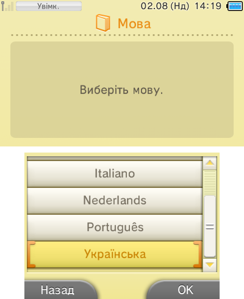</td>
<td>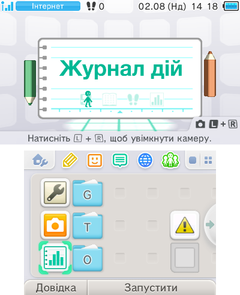</td>
<td>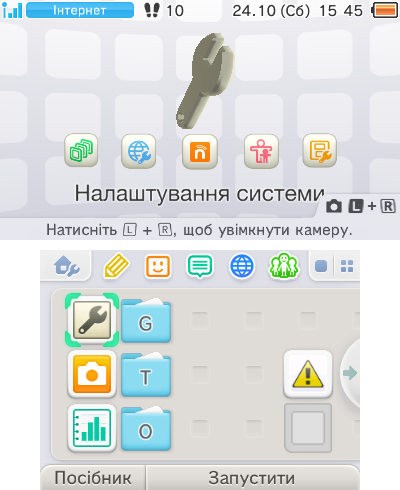</td>
</tr>
<tr>
<td>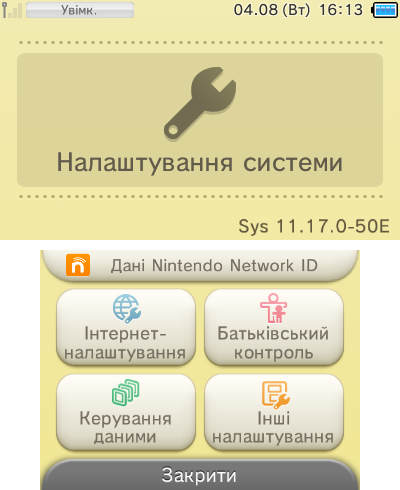</td>
<td>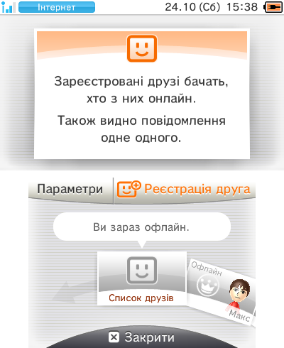</td>
<td>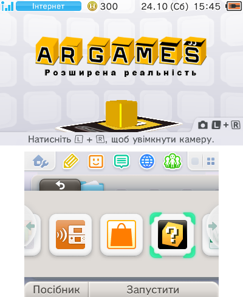</td>
</tr>
<tr>
<td>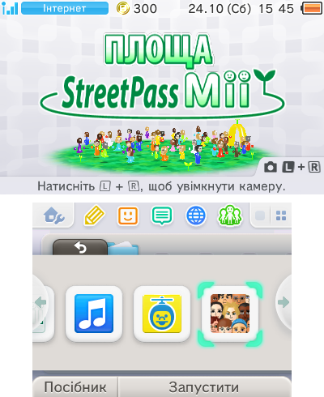</td>
<td>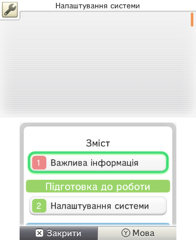</td>
<td>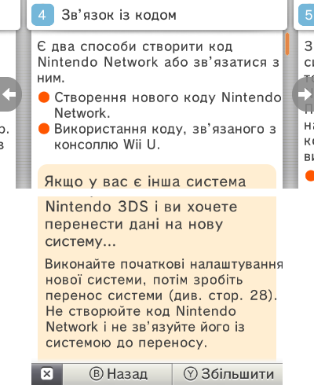</td>
</tr>
</table>

## Що вже українською

Меню HOME (разом з назвами додатків під іконками) · Налаштування системи (разом з назвами програм у **Керуванні даними**) · Mii Maker · Журнал дій · Електронний посібник · Гра по завантаженню · екранна клавіатура з українською розкладкою · Список друзів · Камера Nintendo 3DS · швидка камера на `L`+`R` · Звук Nintendo 3DS · Здоров'я і безпека · Площа StreetPass Mii · Вибір Mii · Сповіщення (разом з **вбудованими підказками**, що прийшли з першим запуском консолі) · Ігрові записи · екран помилки · Інтернет-браузер · Nintendo eShop · Перенесення даних · Оглядач Nintendo Zone · Face Raiders · AR Games · Налаштування amiibo · аплет покупок і оновлень eShop · 3DS Memo · аплет Circle Pad Pro · Miiverse · публікація в Miiverse · **Дані Nintendo Network ID** (повністю: вхід, інформація про користувача, налаштування пароля, зміна Mii, підтвердження пошти — усі 290 написів) · **тексти помилок системи** (усі 259 повідомлень) · список країн і регіонів у налаштуваннях профілю та на Карті StreetPass (усі 67 країн і всі 724 їхні області) · назва панелі в Обміні частинками · **електронні довідники** дванадцяти додатків: Інтернет-браузера, Налаштувань системи, Журналу дій, Гри по завантаженню, Камери, Звуку, Mii Maker, Площі StreetPass Mii, Nintendo eShop, Face Raiders, AR Games та Інтернет-браузера New 3DS · **власні титули New 3DS**: банер і назва Здоров'я і безпеки, сам додаток Здоров'я і безпека разом з його документом та окремий Інтернет-браузер New 3DS.

## Що потрібно

- Nintendo 3DS / 3DS XL / 2DS / New 3DS / New 3DS XL / New 2DS XL **європейського (EUR) регіону**
- встановлена **Luma3DS v10.3 або новіша** — кастомна прошивка. Для справжніх літер `і ї є ґ` потрібна **v13.0 або новіша**, тож краще найновіша
- SD-карта з 40 МБ вільного місця
- заряджена батарея або зарядка — застосунок не почне на низькому заряді

Немає Luma3DS? Спершу пройдіть [3ds.hacks.guide](https://3ds.hacks.guide/) — без неї мод не працює.

## Встановлення

**1. Поставте застосунок «Українізатор 3DS».**

Через [Universal-Updater](https://github.com/Universal-Team/Universal-Updater) — нічого додавати не треба, застосунок лежить в Universal-DB, його основному магазині:

1. Відкрийте Universal-Updater і знайдіть **Українізатор 3DS/2DS** — лупою в лівій панелі нижнього екрана, введіть «Українізатор».
2. Відкрийте другу іконку згори — «Доступні для завантаження» — і виберіть `3ds-ua-installer-<версія>.cia`.
3. Дочекайтеся, поки запис зникне з черги (третя іконка згори).

Без Universal-Updater: візьміть `3ds-ua-installer-<версія>.cia` з [Releases](../../releases), скопіюйте на SD-карту й встановіть через FBI.

**2. Відкрийте «Українізатор 3DS»** у меню HOME. Застосунок перевірить консоль: Luma, регіон, місце на картці й заряд — і скаже, якщо чогось бракує.

**3. Натисніть «Встановити»** і виберіть, яку мову замінить українська: «Замість російської» або «Замість англійської». Та мова зникне зі списку мов, решта лишиться.

Кілька хвилин консоль не вимикайте — кнопка HOME у цей час не працює. Потім консоль перезавантажиться сама й запуститься українською. Готово.

<table>
<tr>
<td>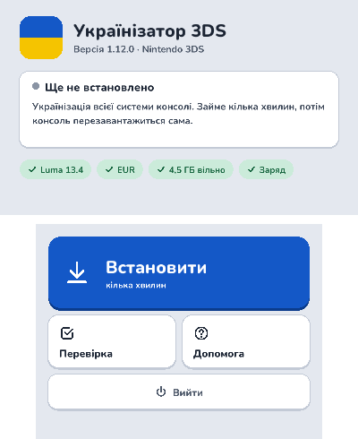</td>
<td>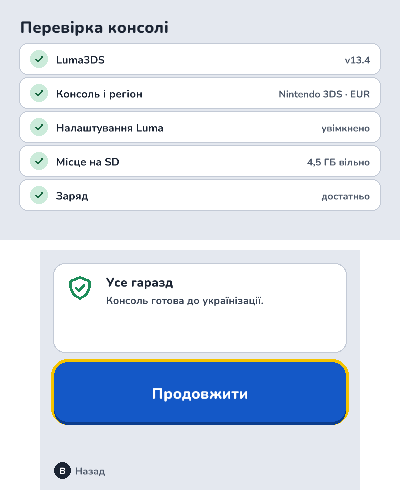</td>
<td>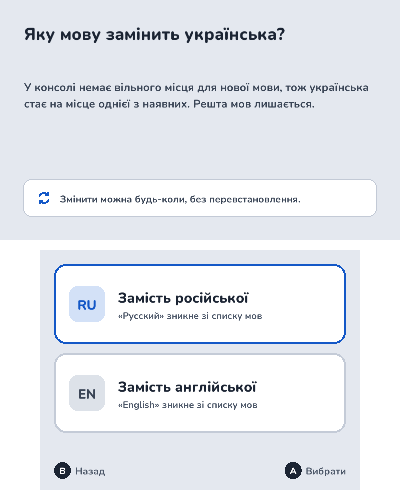</td>
</tr>
<tr>
<td>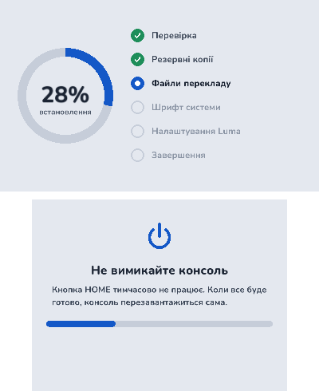</td>
<td>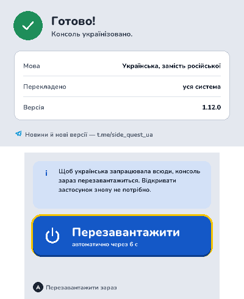</td>
<td>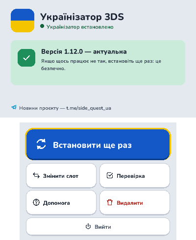</td>
</tr>
</table>

Українізатор уже стоїть — від Universal-Updater 1.x чи з архіву? Ставте застосунок поверх і натисніть «Оновити»: він підхопить наявні файли, видаляти нічого не треба.

Керувати застосунком можна і сенсорним екраном, і кнопками: хрестовина вибирає, **A** натискає.

### Оновлення і зміна мови

Коли вийде нова версія, на іконці **Українізатор 3DS/2DS** в Universal-Updater з'явиться зелена стрілка. Встановіть новий CIA, відкрийте застосунок і натисніть «Оновити». Застосунок сам знає, що встановлено, і міняє лише змінене.

Замінити не ту мову — «Змінити слот» у застосунку, без перевстановлення.

Додавали колись окремий магазин `3ds-ua.unistore`? Він теж ставить застосунок — пункт «Встановити застосунок», — але все те саме є в Universal-DB.

### Вручну, з архіву

Для тих, хто ставить файли на картку руками. Справжніх літер в архівах немає (`i ï ε г` замість `і ї є ґ`), а Luma й мову треба налаштовувати самому.

Візьміть з [Releases](../../releases) один архів: `-from-ru-` ставить українську замість російської, `-from-en-` — замість англійської; `-old3ds` для 3DS / 3DS XL / 2DS, `-new3ds` для New 3DS / New 3DS XL / New 2DS XL. Як відрізнити New: у неї є маленький сірий C-стик над кнопками A/B/X/Y і додаткові кнопки ZL/ZR згори. Не той архів дає креш Здоров'я і безпеки й наполовину неперекладений браузер: New 3DS має власні копії цих двох програм.

1. Вимкніть консоль, вставте SD-карту в комп'ютер, розпакуйте архів і скопіюйте папку `luma` в корінь картки — туди, де вже є папка `luma`. Комп'ютер спитає, чи об'єднати папки — погодьтеся.
2. Тримайте **SELECT** і увімкніть консоль — з'явиться синє меню Luma. Позначте **`Enable game patching`** (сьомий рядок, кнопка **A**, навпроти з'явиться `(x)`) і натисніть **START**.
3. `Налаштування системи` → `Інші налаштування` → `Мова` → **Українська** → `OK`. Це пункт, де раніше було «Русский» (у `from-en` — «English»). Консоль перезавантажиться сама.

## Як видалити

**Застосунком:** «Українізатор 3DS» → «Видалити». Застосунок прибере свої файли й шрифт, поверне файли інших модів, які довелося відкласти, вимкне завантаження зовнішніх модулів Luma, якщо вмикав його сам, і перезавантажить консоль. `Enable game patching` лишається: ним можуть користуватися інші моди. Сам застосунок лишиться в меню HOME — українізувати знову можна будь-коли; прибрати його можна в `Налаштування системи` → `Керування даними`.

**Встановлено з архіву:** видаліть папки мода з `SD:/luma/titles/` — усі вони перелічені в [таблиці](docs/internals.md#що-за-папки-в-lumatitles) (32 на New 3DS, 30 на Old 3DS), — або поставте застосунок і натисніть «Видалити».

**Один виняток.** Вбудовані підказки у Сповіщеннях консоль колись скопіювала собі в NAND, і файлами на SD-карті їх уже не дістати — мод переписує їх у самій базі. Після видалення мода вони лишаться українськими (не зіпсованими — просто українськими). Нові листи мод не чіпає.

## Анонімна статистика

Щоб знати, скільки консолей українізовано і де щось ламається, застосунок після встановлення, оновлення, видалення чи помилки надсилає короткий звіт. Тільки якщо консоль під'єднана до Wi-Fi і на екрані «Допомога» стоїть галочка «Анонімна статистика» — вона ввімкнена одразу, зняти можна будь-коли. Без Wi-Fi чи без галочки застосунок навіть не пробує з'єднатися.

**Що в звіті:** випадковий ID установки (його видно дрібно внизу екрана «Допомога»), що сталося (встановлення, оновлення, видалення, помилка), версія застосунку, модель консолі, версія системи й Luma, регіон, яку мову замінила українська, чи поставилися справжні літери, скільки тривало і короткий технічний підсумок — час етапів, а для помилки етап і файл.

**Чого немає:** IP-адреси, країни, серійного номера, Friend Code, імені, Mii — нічого, що вказує на вас. ID — просто випадкові символи, створені на консолі; він лежить у `3ds/3ds-ua-installer.ini`, і якщо видалити цей файл, наступного разу буде новий.

Якщо щось не працює, надішліть у [Telegram-канал](https://t.me/side_quest_ua) фото екрана «Допомога»: за ID ми знайдемо ваш звіт. Так само за ID видалимо ваші записи, якщо попросите. Сервер — Cloudflare Worker і база D1, код у [stats/](stats/).

## Чого поки що немає

- **України в списку країн немає.** У таблиці кодів країн Nintendo її немає взагалі: європейський блок суцільний, без пропусків, `…99 Румунія, 100 Росія, 101 Сербія…`. Код країни — системна величина, від якої залежать NNID, eShop і вікові рейтинги, і нового рядка в таблицю не вставити. Раніше мод перейменовував код `100` на «Україна» разом з його областями — але **назву за цим кодом кожен читає своєю таблицею**, тому інші гравці в онлайні, NNID, eShop і StreetPass однаково бачили «Росія», а українська область показувалася їм російською, що стоїть під тим самим номером. Тепер список показує те, що консоль справді повідомляє: код `100` — це `росія (болота)` з її ж 83 областями, усе з малої літери. Плутанини регіонів в онлайні більше немає.

  **Мова й країна в 3DS ніяк не пов'язані:** переклад стоїть на мовному слоті, тому інтерфейс лишиться повністю українським з будь-якою країною в профілі — ставте будь-яку.
- **Справжніх `і ї є ґ` в архівах.** Їх ставить лише застосунок: він будує шрифт з власного шрифту консолі, а консоль читає його з SD-карти. Потрібна Luma3DS v13.0 або новіша; на старішій, а також коли на картці вже стоїть чужий патч модуля NS, застосунок лишає замінники `i ï ε г`. Як це влаштовано — у [технічному описі](docs/internals.md#справжні-українські-літери-в-системному-шрифті).
- **Електронних довідників решти додатків.** Переглядач бере довідник кожного додатка окремо, тож кожен треба здампити з вашої консолі й перекласти. Готові шістнадцять — Інтернет-браузера, Налаштувань системи, Журналу дій, Гри по завантаженню, Камери, Звуку, Mii Maker, Площі StreetPass Mii, Nintendo eShop, Face Raiders, AR Games, а на New 3DS ще Інтернет-браузера, Меню HOME, Списку друзів, Сповіщень та Ігрових записів, усі повністю (на Old 3DS у Меню HOME, Списку друзів, Сповіщень та Ігрових записів довідників немає взагалі); решта показує той самий довідник, що й раніше. Місця лишилося небагато: таблиця шляхів переглядача та таблиця назв додатків займають 815 із 1064 байтів вільного місця в його коді, а самій таблиці шляхів вистачить ще на два довідники. Довідники ігор належать іграм, а не системі, тож лишаються як є.
- **Назв додатків у eShop, Перенесенні даних та Ігрових записах** — там вони лишаються мовою, яку мод займає. У Меню HOME, Журналі дій, Керуванні даними та Електронному довіднику вони українські.
- **Електронні довідники у варіанті «Замість англійської» (`from-en`)** беруть за основу російський документ: у нього більше сторінок, ніж в англійського, тому в українську клітинку лягає він цілком, зі своїми знімками екрана. Сам російський довідник при цьому лишається на місці.
- **Кириличної клавіатури на російській мові у варіанті «Замість англійської» (`from-en`).** Аплет клавіатури дозволяє кирилицю рівно одній мові консолі, і в цій збірці вона віддана українській. Сам російський інтерфейс лишається на місці, але клавіатура на ньому буде латинською. У варіанті «Замість російської» такого немає.
- **Збірки для консолей USA та JPN.** Європейських мовних слотів у них немає, тож потрібна окрема збірка — напишіть в Issues, якщо вона вам потрібна.

## Якщо щось пішло не так

| Що бачите | Що робити |
|---|---|
| Консоль не запускається після встановлення | Вимкніть її, тримайте **SELECT** і увімкніть. У меню Luma зніміть галочку **`Enable loading external FIRMs and modules`** і натисніть **START**. Консоль запуститься з замінниками замість `і ї є ґ`; відкрийте застосунок — він сам усе виправить. Системні файли консолі не змінювалися. |
| Вимкнулося живлення посеред встановлення | Нічого не зламано: відкрийте застосунок, він продовжить з того самого місця. |
| Застосунок пише, що `Enable game patching` вимкнено | Ця галочка злітає після оновлення Luma. Натисніть «Увімкнути»; якщо такої кнопки немає (стара Luma), застосунок покаже, як увімкнути вручну. |
| «Низький заряд» | Підключіть зарядку — далі застосунок піде сам. |
| Замінники `i ï ε г` замість `і ї є ґ` | Luma старша за v13.0, на картці чужий патч модуля NS, або встановлено з архіву. Оновіть Luma і натисніть у застосунку «Встановити ще раз». |
| Назви додатків українські, а кнопки Меню HOME («Помощь», «Запустить») і статус-бар — ні | Luma старша за v10.3: вона не вміє підміняти файли Меню HOME. Оновіть Luma за [3ds.hacks.guide](https://3ds.hacks.guide/updating-b9s). |
| `An exception occurred` при запуску якогось додатка | У вас старіша версія цього додатка. Видаліть його папку `SD:/luma/titles/<номер>` цілком і перезавантажте — він запуститься без перекладу. Номери папок — у [технічному описі](docs/internals.md#що-за-папки-в-lumatitles). І [напишіть в Issues](../../issues) з фото екрана. |
| Меню HOME не завантажується | Видаліть `SD:/luma/titles/0004003000009802/code.ips`. Не допомогло — усю папку `0004003000009802`. |
| Частина тексту не українською | Так і має бути: технічні написи (`OK`, `Miiverse`, формати дат) лишені як є. |
| У списку країн немає України | Свого коду в системі Україна не має — [чому](#чого-поки-що-немає). Ставте будь-яку країну, інтерфейс лишиться українським. |
| Не можу знайти українізатор в Universal-Updater | Шукайте лупою в лівій панелі: «Українізатор». Має бути вибраний магазин **Universal-DB** (шестерня → `Select UniStore`). |
| Не видно нової версії | Universal-Updater перечитує магазин лише з автооновленням. Примусово: шестерня → `Select UniStore` → підсвітити **Universal-DB** → **START**. Новий реліз потрапляє в Universal-DB не миттєво — дайте йому кілька годин. |
| У Universal-Updater помилка завантаження | Зникла мережа, або збита дата на консолі — тоді не проходить перевірка сертифіката. Можна взяти CIA з Releases вручну. |
| Архів: інтерфейс лишився як був | Не увімкнено `Enable game patching`, або шлях не той: має бути `luma/titles/…`, а не `luma/luma/titles/…`. І перевірте, що вмикали ту мову, місце якої займає архів. |

Порожні квадрати замість літер, обрізані чи накладені написи — це баг. [Відкрийте Issue](../../issues) з фото екрана; якщо ставили застосунком — додайте файл `3ds/3ds-ua-installer.log` з SD-карти.

## Як допомогти

- **Знайшли помилку чи кривий переклад** — [відкрийте Issue](../../issues/new/choose). Там два шаблони: «Баг на консолі» і «Кривий переклад» — вони самі спитають усе потрібне. Фото екрана допомагає найбільше.
- **Хочете виправити самі** — правте поле `ua` у `src/strings/<додаток>/*.json` (поруч у полі `en` — оригінал) і надсилайте Pull Request. Терміни звіряйте з [глосарієм](src/glossary.md), а перед PR запустіть `make validate`: воно перевірить, що текст влазить на екран і не містить символів, яких у шрифті немає. Про збірки думати не треба — переклад один на обидві, бо межі ширини рахуються від найдовшої офіційної локалізації, а не від слота.
- **Знаєте, чого ще бракує** — [напишіть в Issues](../../issues). Там же видно, що вже взяте в роботу.

## Технічні деталі

Як воно влаштовано: за що відповідає кожна папка, чому частині додатків потрібна правка коду, звідки беруться назви під іконками, як застосунок ставить файли й переживає обрив живлення і як шрифт з `і ї є ґ` потрапляє в систему без запису в NAND — **[docs/internals.md](docs/internals.md)**.

Зібрати мод і застосунок самому зі своїх дампів — **[docs/dumping.md](docs/dumping.md)**.

## Ліцензія

Код інструментів і застосунку та текст перекладу — MIT; шрифт інтерфейсу застосунку Nunito — SIL OFL. Файлів Nintendo в репозиторії немає; збірка потребує дампу з власної консолі, а шрифт зі справжніми літерами застосунок будує на консолі з її власного. Проєкт неофіційний, з Nintendo не пов'язаний.

---

## In English

**Ukrainian system language for the Nintendo 3DS.** Ukrainian takes the place of one of the console's languages — Russian or English — and the console starts speaking Ukrainian. Every other language stays untouched.

**It installs with an app.** «Українізатор 3DS» goes onto the console like any other program and does everything itself: picks the files for your console, turns on what Luma needs, adds the real letters **і ї є ґ** to the system font and reboots. No need to change the console language. Updating, switching the slot and removing all happen in the same app, one press each.

Nothing in the console's system files is modified — it all lives on the SD card, the font included. If the power goes out mid-install, the app picks up where it stopped.

**The goal is a complete Ukrainian localisation** of everything visible on screen. **32 parts of the system plus sixteen electronic manuals** are done so far; work continues.

### Already in Ukrainian

HOME Menu (including the application names under the icons) · System Settings (including the software names in **Data Management**) · Mii Maker · Activity Log · Instruction Manual · Download Play · Software Keyboard with a Ukrainian layout · Friend List · Camera · the quick camera on `L`+`R` · Sound · Health & Safety · StreetPass Mii Plaza · Mii Selector · Notifications (including the **built-in tips** that arrived with the console's first boot) · Game Notes · error applet · Internet Browser · Nintendo eShop · System Transfer · Nintendo Zone · Face Raiders · AR Games · amiibo Settings · the eShop purchase/update applet · 3DS Memo · the Circle Pad Pro applet · Miiverse · Miiverse posting · **Nintendo Network ID Settings** (in full: sign-in, user information, password settings, Mii, email verification - all 290 strings) · the **system error messages** (all 259 of them) · the country and region lists in the profile settings and on the StreetPass Map (all 67 countries and all 724 of their regions) · the Puzzle Swap panel name · the **electronic manuals** of twelve titles, in full: Internet Browser, System Settings, Activity Log, Download Play, Camera, Sound, Mii Maker, StreetPass Mii Plaza, Nintendo eShop, Face Raiders, AR Games and the New 3DS Internet Browser · the **New 3DS titles of its own**: the Health & Safety banner and icon name, the Health & Safety application together with its document, and the separate New 3DS Internet Browser.

### Requirements

- a Nintendo 3DS / 3DS XL / 2DS / New 3DS / New 3DS XL / New 2DS XL of the **European (EUR) region**
- **Luma3DS v10.3 or newer** custom firmware. The real letters `і ї є ґ` need **v13.0 or newer**, so the latest is best
- an SD card with 40 MB free
- a charged battery or the charger — the app will not start on a low battery

No Luma3DS yet? Follow [3ds.hacks.guide](https://3ds.hacks.guide/) first — the mod does nothing without it.

### Installation

**1. Install the «Українізатор 3DS» app.**

With [Universal-Updater](https://github.com/Universal-Team/Universal-Updater) — nothing to add, the app is in Universal-DB, its main store:

1. Open Universal-Updater and find **Українізатор 3DS/2DS** — the magnifier in the bottom screen's left sidebar, type «Українізатор».
2. Open the second icon down — the downloads tab — and pick `3ds-ua-installer-<version>.cia`.
3. Wait until the entry leaves the queue (third icon down).

Without Universal-Updater: grab `3ds-ua-installer-<version>.cia` from [Releases](../../releases), copy it to the SD card and install it with FBI.

**2. Open «Українізатор 3DS»** from the HOME Menu. The app checks the console — Luma, region, free space and battery — and tells you if something is missing.

**3. Press «Встановити» (Install)** and pick which language Ukrainian replaces: «Замість російської» (Russian) or «Замість англійської» (English). That language leaves the language list; the rest stay.

Keep the console on for a few minutes — the HOME button is disabled meanwhile. Then the console reboots by itself and comes up in Ukrainian. Done.

<table>
<tr>
<td></td>
<td></td>
<td></td>
</tr>
<tr>
<td></td>
<td></td>
<td></td>
</tr>
</table>

Already have the mod from the 1.x Universal-Updater scripts or an archive? Install the app on top and press «Оновити» (Update): it takes over the files already there, nothing to delete first.

The app works with the touch screen and with buttons: the D-pad moves, **A** presses.

#### Updating and switching the slot

When a new version ships, a green arrow appears on the **Українізатор 3DS/2DS** icon in Universal-Updater. Install the new CIA, open the app and press «Оновити». The app knows what is installed and changes only what changed.

Replaced the wrong language? «Змінити слот» (Change slot) in the app, no reinstall.

Added the separate `3ds-ua.unistore` store at some point? It installs the app too — the «Встановити застосунок» line — but everything is in Universal-DB anyway.

#### By hand, from an archive

For those who copy files onto the card themselves. The archives have no real letters (`i ï ε г` stand in for `і ї є ґ`), and Luma and the language are up to you.

Grab one archive from [Releases](../../releases): `-from-ru-` puts Ukrainian in place of Russian, `-from-en-` in place of English; `-old3ds` is for the 3DS / 3DS XL / 2DS, `-new3ds` for the New 3DS / New 3DS XL / New 2DS XL. A New model has a small grey C-stick above A/B/X/Y and extra ZL/ZR buttons. The wrong archive crashes Health and Safety and leaves the browser half translated: the New 3DS runs its own copies of those two.

1. Power the console off, put the SD card in your computer, unpack the archive and copy the `luma` folder into the card's root — where a `luma` folder already exists. Agree when your computer offers to merge them.
2. Hold **SELECT** and power the console on — the blue Luma menu appears. Select **`Enable game patching`** (7th line, **A**, so it reads `(x)`) and press **START**.
3. `System Settings` → `Other Settings` → `Language` → **Українська** → `OK`. That is the entry that used to read «Русский» («English» in `from-en`). The console reboots itself.

### Uninstalling

**With the app:** «Українізатор 3DS» → «Видалити» (Remove). The app removes its files and the font, puts back other mods' files it had set aside, turns Luma's external modules back off if it turned them on, and reboots. `Enable game patching` stays on, since other mods may use it. The app itself stays on the HOME Menu, ready to install again; remove it in `System Settings` → `Data Management` if you like.

**Installed from an archive:** delete the mod folders from `SD:/luma/titles/` — every one is listed in [the table](docs/internals.en.md#what-each-folder-under-lumatitles-is) (32 on New 3DS, 30 on Old 3DS) — or install the app and press «Видалити».

**One exception.** The built-in Notification tips were copied into NAND by the console long ago, and no file on the SD card can reach them — the mod rewrites them inside that database. After you remove the mod they stay Ukrainian (not corrupted — simply Ukrainian). New notifications are never touched.

### Anonymous statistics

To know how many consoles run the mod and where it breaks, the app sends a short report after an install, update, removal or error. Only when the console is on Wi-Fi and the «Анонімна статистика» box on the Help screen is ticked — it is on from the start and can be unticked at any time. Without Wi-Fi or without the tick the app does not even try to connect.

**In a report:** a random install ID (shown in small print at the bottom of the Help screen), what happened (install, update, removal, error), the app version, the console model, the system and Luma versions, the region, which language Ukrainian replaced, whether the real letters went on, how long it took, and a short technical summary — the stage timings, and for an error the stage and the file.

**Not in it:** IP address, country, serial number, Friend Code, name, Mii — nothing that points to you. The ID is just random characters made on the console; it lives in `3ds/3ds-ua-installer.ini`, and deleting that file gives a new one next time.

If something doesn't work, send a photo of the Help screen to the [Telegram channel](https://t.me/side_quest_ua): the ID finds your report. Ask, and the ID is also how we delete your records. The server is a Cloudflare Worker with a D1 database; the code is in [stats/](stats/).

### Known limits

- **Ukraine is not in the country list.** Nintendo's country table has no Ukraine at all: the European block runs unbroken, `…99 Romania, 100 Russia, 101 Serbia…`. The country code is a system-wide value that NNID, the eShop and age ratings depend on, and no new row fits in the table. The mod used to rename code `100` to «Україна» along with its regions — but **every other machine resolves that code with its own table**, so other players online, NNID, the eShop and StreetPass saw Russia anyway, and a Ukrainian oblast reached them as the Russian one sharing its index. The list now says what the console actually reports: code `100` is `росія (болота)` with its own 83 oblasts, lowercase throughout. No more region mix-ups online.

  **Language and country are unrelated on the 3DS:** the translation hangs off the language slot, so the interface stays fully Ukrainian whatever country your profile says — pick any.
- **Real `і ї є ґ` in the archives.** Only the app installs them: it builds the font out of the console's own, and the console reads it off the SD card. It needs Luma3DS v13.0 or newer; on an older one, or when another NS patch is already on the card, the app keeps the substitutes `i ï ε г`. How it works: the [technical write-up](docs/internals.en.md#real-ukrainian-letters-in-the-system-font).
- **The electronic manuals of the remaining titles.** The viewer reads each title's own manual, and each one has to be dumped off your console and translated separately. Sixteen ship in full, five of them New 3DS only (the browser, HOME Menu, Friend List, Notifications and Game Notes - an Old 3DS has no manual for the last four at all); every other title shows the manual it always did. The ceiling is space, not text: the viewer's path table and its SMDH name table share one 1064-byte window of `.rodata` padding, sixteen titles use 815 of it, and the path table itself has room for two more. A game's manual belongs to the game, not to the system, so those stay as they are.
- **Application names in the eShop, System Transfer and Game Notes** are still in the language the mod replaces. In the HOME Menu, the Activity Log, Data Management and the Instruction Manual they are Ukrainian.
- **The electronic manuals in the «Замість англійської» (`from-en`) variant** are built from the Russian document: it has more pages than the English one, so it is copied into the Ukrainian slot whole, its own screenshots included. The Russian manual itself stays where it was.
- **A Cyrillic keyboard under Russian in the «Замість англійської» (`from-en`) variant.** The keyboard applet grants Cyrillic to exactly one system language, and in this build that is Ukrainian. The Russian interface itself stays where it was, but its keyboard will be Latin. The «Замість російської» variant has no such catch.
- **USA and JPN consoles** have none of the European language slots and need a separate build. Open an Issue if you want one.

### If something goes wrong

| Symptom | Fix |
|---|---|
| The console won't boot after installing | Power it off, hold **SELECT** and power on. In the Luma menu untick **`Enable loading external FIRMs and modules`** and press **START**. The console boots with substitutes for `і ї є ґ`; open the app and it sets things right. No system files were modified. |
| The power went out mid-install | Nothing is broken: open the app and it continues where it stopped. |
| The app says `Enable game patching` is off | It resets when you update Luma. Press «Увімкнути» (Turn on); without that button (an old Luma) the app shows how to do it by hand. |
| «Низький заряд» (low battery) | Plug in the charger — the app carries on by itself. |
| Substitutes `i ï ε г` instead of `і ї є ґ` | Luma is older than v13.0, another NS patch is on the card, or the mod came from an archive. Update Luma and press «Встановити ще раз» (Install again) in the app. |
| App names are Ukrainian, but the HOME Menu buttons («Manual», «Open») and status bar are not | Luma is older than v10.3 and cannot replace HOME Menu files. Update Luma via [3ds.hacks.guide](https://3ds.hacks.guide/updating-b9s). |
| `An exception occurred` when opening an app | You have an older build of that app. Delete its whole `SD:/luma/titles/<id>` folder and reboot — it starts untranslated. Folder ids are in the [technical write-up](docs/internals.en.md#what-each-folder-under-lumatitles-is). Please [open an Issue](../../issues) with a photo. |
| HOME Menu won't boot | Delete `SD:/luma/titles/0004003000009802/code.ips`. If that doesn't help, the whole `0004003000009802` folder. |
| Some text is not Ukrainian | Expected: technical strings (`OK`, `Miiverse`, date formats) are left as they are. |
| Ukraine is missing from the country list | The system has no country code for it, see [Known limits](#known-limits). Pick any country; the interface stays Ukrainian. |
| Can't find the mod in Universal-Updater | Search with the magnifier in the left sidebar: «Українізатор». The selected store must be **Universal-DB** (gear → `Select UniStore`). |
| The new version doesn't show up | Universal-Updater refetches the store only with auto-update on. Force it: gear → `Select UniStore` → highlight **Universal-DB** → **START**. A new release reaches Universal-DB with some delay — give it a few hours. |
| Download error in Universal-Updater | The network dropped, or the console clock is wrong, which fails the certificate check. You can grab the CIA from Releases by hand. |
| Archive: the interface is unchanged | `Enable game patching` is off, or the path is wrong: `luma/titles/…`, not `luma/luma/titles/…`. And check you picked the language the archive replaces. |

Empty boxes instead of letters, clipped or overlapping text — that's a bug. [Open an Issue](../../issues) with a photo; if you installed with the app, attach `3ds/3ds-ua-installer.log` from the SD card.

### Contributing

- **Found a mistake or an awkward wording** — [open an Issue](../../issues/new/choose). Two templates are there — «Баг на консолі» (a bug) and «Кривий переклад» (a wording problem) — and they ask for everything needed. A photo of the screen helps most.
- **Want to fix it yourself** — edit the `ua` field in `src/strings/<app>/*.json` (`en` next to it is the original) and send a Pull Request. Check terms against the [glossary](src/glossary.en.md), and run `make validate` first: it checks that the text fits on screen and uses no characters the font lacks. No need to think about the two builds — the translation is shared, because the width budgets come from the longest official localisation rather than from the slot.
- **Know what else is missing** — [tell us in an Issue](../../issues).

### Technical details

How it works — what each folder does, why some titles need a code patch, where the names under the icons come from, how the app installs and survives a power cut, and how the font with `і ї є ґ` reaches the system without a NAND write: **[docs/internals.en.md](docs/internals.en.md)**.

Building the mod and the app from your own dumps: **[docs/dumping.en.md](docs/dumping.en.md)**.

### Licence

Tooling, app code and translation text are MIT; the app's UI font Nunito is SIL OFL. No Nintendo files are in this repository; building requires a dump from your own console, and the app builds the real-letter font on the console out of the console's own. Unofficial project, not affiliated with Nintendo.
